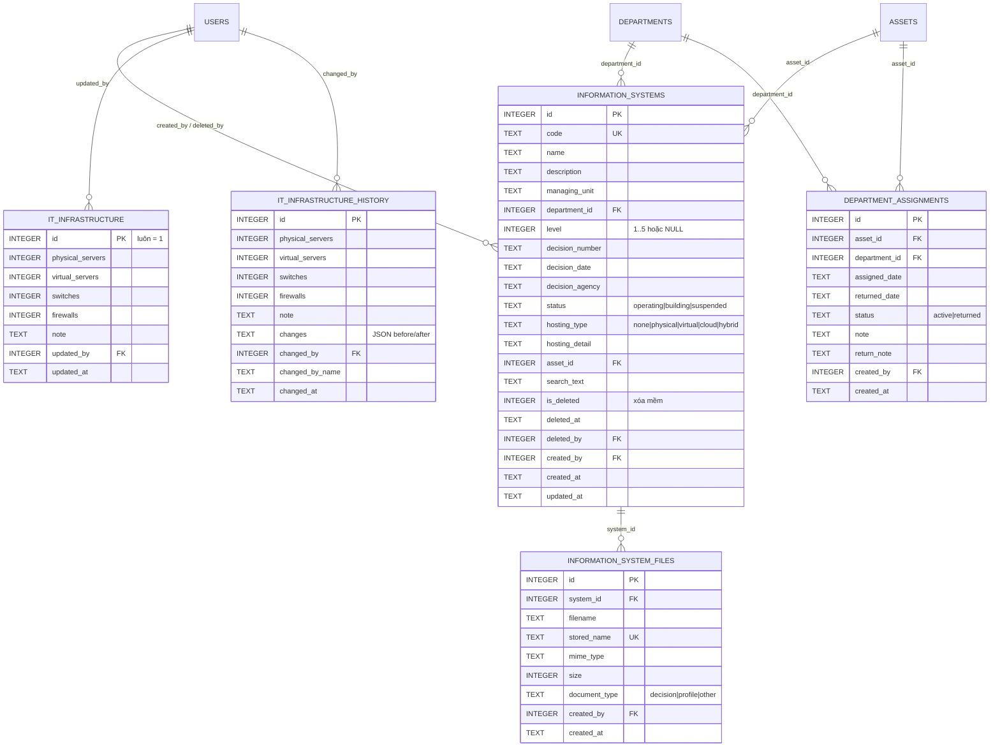

# Hạ tầng CNTT & hệ thống thông tin (HTTT)

Tài liệu thiết kế, danh mục màn hình/API và hướng dẫn sử dụng chức năng **Hạ tầng CNTT** và **Hệ thống thông tin** của Manager Device (v1.0.5).

Phạm vi gồm:

- Số liệu hạ tầng cấp đơn vị: máy chủ vật lý, máy ảo, switch, firewall — kèm lịch sử thay đổi.
- Danh mục HTTT: mã, tên, đơn vị quản lý, cấp độ an toàn 1–5 (hoặc chưa xác định), quyết định phê duyệt, trạng thái, hình thức triển khai, thiết bị liên kết, tệp hồ sơ.
- Dashboard, báo cáo Excel/PDF, nhập hàng loạt từ Excel, nhật ký thao tác.
- Phân bổ thiết bị cho **phòng ban** mà không cần gắn với nhân viên.

---

## 1. Kiến trúc và luồng gọi

Ứng dụng Electron 3 lớp, dữ liệu lưu cục bộ bằng SQLite (`node:sqlite`):

```
Renderer (React)
  └─ window.api.systems / window.api.infrastructure   (src/preload/index.ts)
       └─ ipcRenderer.invoke('systems:*', 'infrastructure:*')
            └─ ipcMain.handle(...)                     (src/main/ipc/index.ts)
                 └─ service (kiểm tra quyền, validate, nghiệp vụ)
                      └─ SQLite (data/manager-device.db)
```

| Lớp | Tệp chính | Vai trò |
| --- | --- | --- |
| Dùng chung | `src/shared/types.ts`, `src/shared/constants.ts`, `src/shared/api.ts` | Kiểu dữ liệu, nhãn/quyền, hợp đồng API |
| IPC | `src/main/ipc/index.ts`, `src/main/lib/schemas.ts` | Đăng ký kênh, phân quyền, validate Zod |
| Nghiệp vụ | `src/main/services/system.service.ts`, `infrastructure.service.ts`, `system-report.service.ts`, `pdf.service.ts` | CRUD, cảnh báo, dashboard, báo cáo, nhập Excel |
| Dữ liệu | `src/main/db/database.ts`, `src/main/db/seed.ts` | Migration `SCHEMA_V3`, dữ liệu mẫu |
| Giao diện | `src/renderer/src/pages/systems/*` | Danh sách HTTT, form, hạ tầng |
| Liên kết thiết bị | `src/main/services/asset.service.ts`, `assignment.service.ts` | Phân bổ nhân viên/phòng ban |

Mọi thao tác ghi đều đi qua service để ghi **nhật ký hoạt động** (`activity_logs`), không có đường tắt từ renderer xuống SQLite.

---

## 2. Mô hình dữ liệu

### 2.1 Sơ đồ quan hệ (ERD)



### 2.2 Bảng mô tả nhanh

| Bảng | Khóa/Quan hệ | Ghi chú |
| --- | --- | --- |
| `it_infrastructure` | `id = 1` (một bản ghi) | Số liệu hiện tại; `updated_by` → `users`, `ON DELETE SET NULL` |
| `it_infrastructure_history` | `changed_by` → `users` | Mỗi lần lưu tạo một dòng, kèm `changes` JSON |
| `information_systems` | `department_id` → `departments`, `asset_id` → `assets` | `department_id`/`asset_id` xóa thì `SET NULL`; `code` duy nhất toàn bảng |
| `information_system_files` | `system_id` → `information_systems` | Xóa HTTT cứng sẽ `CASCADE`; HTTT xóa mềm vẫn giữ tệp |
| `department_assignments` | `asset_id` → `assets` (`CASCADE`), `department_id` → `departments` (`RESTRICT`) | Lịch sử phân bổ phòng ban, tách khỏi `asset_assignments` |

Thay đổi trên bảng `assets` (migration `SCHEMA_V3`):

| Cột | Kiểu | Ý nghĩa |
| --- | --- | --- |
| `allocation_type` | `TEXT NOT NULL DEFAULT 'none'` | `none` / `employee` / `department` |
| `department_id` | có sẵn | Phòng ban đang giữ/ sử dụng thiết bị, dùng cho cả hai hình thức |
| `assigned_employee_id` | có sẵn | Chỉ có giá trị khi `allocation_type = 'employee'` |

Migration chạy tuần tự theo `PRAGMA user_version`; `SCHEMA_V3` là migration thứ 3, chạy trong `BEGIN/COMMIT`.

### 2.3 Quy ước dữ liệu

- Thời điểm lưu dạng ISO UTC (`YYYY-MM-DDTHH:mm:ss.sssZ`), ngày nghiệp vụ dạng `YYYY-MM-DD`.
- Cấp độ dùng `NULL` cho “Chưa xác định cấp độ”, không dùng `0`.
- Xóa HTTT là **xóa mềm** (`is_deleted = 1`), không xóa dòng và không giải phóng `code`.
- Tệp đính kèm lưu tại `userData/uploads` với tên UUID; tên gốc lưu trong `filename`.
- `search_text` là chuỗi đã bỏ dấu, viết thường của mã + tên + mô tả + đơn vị + số QĐ + cơ quan ban hành.

---

## 3. Màn hình

| Đường dẫn | Component | Quyền xem | Chức năng chính |
| --- | --- | --- | --- |
| `/systems` | `pages/systems/SystemsPage.tsx` | `report:read` | 4 thẻ KPI, cảnh báo, tìm kiếm/lọc, bảng HTTT, xuất Excel/PDF, nhập Excel, tải mẫu, sửa/xóa |
| `/infrastructure` | `pages/systems/InfrastructurePage.tsx` | `report:read` | 4 thẻ số liệu + tổng, ghi chú, lịch sử thay đổi, cập nhật số liệu |
| Drawer “Thêm/Cập nhật HTTT” | `pages/systems/SystemFormDrawer.tsx` | `system:write` | Form đầy đủ, kiểm tra cấp độ/quyết định, đính kèm tệp |
| `/` | `pages/DashboardPage.tsx` | `report:read` | Khối “Hạ tầng CNTT & hệ thống thông tin”: tổng HTTT, tỷ lệ phê duyệt, chưa xác định cấp độ, tổng thiết bị hạ tầng; link sang `/systems` |
| `/settings` → tab **Thiết lập hệ thống** | `pages/settings/SettingsPage.tsx` | `settings:write` | Công tắc “Cho phép nhiều HTTT dùng chung số quyết định” |
| `/assets` | `pages/assets/AssetsPage.tsx` | `asset:write` | Cột “Người sử dụng / Phòng ban”, bộ lọc “Hình thức phân bổ” |
| `/assets/:id` | `pages/assets/AssetDetailPage.tsx` | `asset:write` | Hình thức phân bổ, người sử dụng, lịch sử phân bổ phòng ban |
| `/activity` | `pages/activity/ActivityPage.tsx` | `log:read` | Nhật ký entity `Hệ thống thông tin`, `Hạ tầng CNTT` |

### 3.1 Màn hình danh sách HTTT

- **KPI**: tổng HTTT, tỷ lệ đã phê duyệt (có cấp độ + số QĐ), số chưa xác định cấp độ (kèm số cấp độ ≥ 3), tổng thiết bị hạ tầng.
- **Phân bố**: biểu đồ thanh theo cấp độ (chưa xác định + 1–5) kèm số lượng/tỷ lệ; thẻ trạng thái vận hành và top đơn vị quản lý nhiều HTTT.
- **Cảnh báo**: hiển thị tối đa 4 HTTT ưu tiên cao nhất; bấm mã để mở form sửa.
- **Bộ lọc**: từ khóa (mã, tên, đơn vị, số QĐ), cấp độ (1–5 / chưa xác định), trạng thái, phòng ban, khoảng ngày cập nhật.
- **Bảng**: tên + mã + nơi triển khai, đơn vị/phòng ban, cấp độ, số QĐ + ngày ký, trạng thái, ngày cập nhật + số tệp, nút sửa/xóa.
- **Hành động**: Thêm HTTT, Mẫu nhập, Nhập Excel, Xuất Excel, Xuất PDF.
- Bộ lọc thời gian lọc theo **ngày cập nhật** (`updated_at`) và áp dụng cho cả bảng đang xem lẫn báo cáo xuất ra.

### 3.2 Form HTTT

Các nhóm trường:

1. Mã HTTT (bỏ trống để tự sinh `HTTT-0001`) + trạng thái.
2. Tên (bắt buộc, duy nhất) + mô tả/chức năng.
3. Đơn vị quản lý, vận hành (bắt buộc) + phòng ban liên kết.
4. Cấp độ 1–5/“Chưa xác định”, số QĐ (bắt buộc nếu có cấp độ), ngày ký, cơ quan ban hành; cảnh báo tại chỗ khi cấp độ ≥ 3.
5. Hình thức triển khai + chi tiết máy chủ/hạ tầng.
6. Thiết bị liên kết (chọn từ danh mục thiết bị).
7. Tệp đính kèm: quyết định / hồ sơ đề xuất / tài liệu khác (PDF, Word, Excel) — chỉ hiển thị khi sửa bản ghi đã lưu.

---

## 4. API / IPC

Tất cả kênh trả về `{ ok: true, data }` hoặc `{ ok: false, error }`; renderer dùng `api.*` đã bọc sẵn.

| Kênh IPC | API renderer | Quyền | Mô tả |
| --- | --- | --- | --- |
| `infrastructure:get` | `api.infrastructure.get()` | `report:read` | Số liệu hiện tại + tối đa 100 mục lịch sử |
| `infrastructure:update` | `api.infrastructure.update(data)` | `infrastructure:write` | Lưu 4 số liệu + ghi chú, tạo bản ghi lịch sử và nhật ký |
| `systems:list` | `api.systems.list(params)` | `report:read` | Danh sách phân trang, tìm kiếm/lọc/sắp xếp |
| `systems:get` | `api.systems.get(id)` | `report:read` | Chi tiết HTTT + danh sách tệp |
| `systems:nextCode` | `api.systems.nextCode()` | `system:write` | Sinh mã kế tiếp `HTTT-XXXX` |
| `systems:save` | `api.systems.save(data)` | `system:write` | Tạo/cập nhật; trả `{ system, warnings }` |
| `systems:remove` | `api.systems.remove(id)` | `system:delete` | Xóa mềm |
| `systems:dashboard` | `api.systems.dashboard()` | `report:read` | KPI, phân bố cấp độ/trạng thái/đơn vị, cảnh báo, hạ tầng |
| `systems:summary` | `api.systems.summary()` | `report:read` | KPI rút gọn dùng cho Dashboard |
| `systems:uploadFile` | `api.systems.uploadFile(systemId, type)` | `system:write` | Chọn và đính kèm tệp |
| `systems:openFile` | `api.systems.openFile(id)` | `report:read` | Mở tệp bằng ứng dụng hệ thống |
| `systems:removeFile` | `api.systems.removeFile(id)` | `system:write` | Xóa tệp (DB + đĩa) |
| `systems:exportExcel` | `api.systems.exportExcel(params)` | `report:read` | Xuất Excel 3–4 sheet theo bộ lọc |
| `systems:exportPdf` | `api.systems.exportPdf(params)` | `report:read` | Xuất PDF A4 ngang |
| `systems:importExcel` | `api.systems.importExcel()` | `system:write` | Nhập hàng loạt, trả `ImportResult` |
| `systems:downloadTemplate` | `api.systems.downloadTemplate()` | `report:read` | Tải mẫu Excel + sheet hướng dẫn |

Tham số danh sách (`InformationSystemListParams`):

```ts
{
  page?: number            // ≥ 1
  pageSize?: number        // 5..1000
  search?: string
  level?: 1|2|3|4|5|'unset'|'all'
  status?: 'operating'|'building'|'suspended'|'all'
  departmentId?: number|null
  managingUnit?: string
  fromDate?: 'YYYY-MM-DD'|null
  toDate?: 'YYYY-MM-DD'|null
  sortBy?: 'code'|'name'|'level'|'updatedAt'
  sortDir?: 'asc'|'desc'
}
```

---

## 5. Quy tắc nghiệp vụ

### 5.1 Hạ tầng CNTT

- Bốn số liệu là **số nguyên không âm**; schema Zod chặn số âm/số lẻ, service tiếp tục chuẩn hóa `Math.max(0, Math.trunc(...))`.
- Một bản ghi duy nhất (`id = 1`); lần đầu tự tạo với giá trị 0.
- Mỗi lần lưu:
  - So sánh trước/sau từng trường (kể cả ghi chú), tạo mảng `changes`.
  - Ghi `it_infrastructure_history` với người thực hiện (`changed_by`, `changed_by_name`) và thời điểm.
  - Ghi nhật ký `Cập nhật hạ tầng CNTT` (entity `infrastructure`).
- Nếu không có thay đổi nào, vẫn ghi lịch sử (mảng `changes` rỗng) để lưu dấu lần cập nhật.

### 5.2 Hệ thống thông tin

| Quy tắc | Cách xử lý |
| --- | --- |
| Mã | Tự sinh `HTTT-%04d` theo mã lớn nhất hiện có; nhập tay được, tự viết hoa; **duy nhất toàn bảng** (kể cả bản ghi đã xóa mềm) |
| Tên | Bắt buộc 2–200 ký tự; **duy nhất không phân biệt hoa/thường** trong các bản ghi chưa xóa |
| Đơn vị quản lý | Bắt buộc 2–200 ký tự |
| Cấp độ | Chỉ `1..5` hoặc `NULL`; mọi giá trị khác bị schema chặn |
| Cấp độ ⇒ số QĐ | Nếu `level != null` mà không có `decisionNumber` → **chặn lưu** với lỗi nghiệp vụ |
| Số QĐ duy nhất | Mặc định so trùng (không phân biệt hoa/thường) trên các HTTT chưa xóa. Bật `allowSharedDecisionNumber` trong Cài đặt để cho phép dùng chung |
| Ngày ký / cơ quan | Tùy chọn; chỉ bắt buộc ở mức **cảnh báo** khi cấp độ ≥ 3 |
| Trạng thái | `operating` / `building` / `suspended` |
| Hình thức triển khai | `none` / `physical` / `virtual` / `cloud` / `hybrid` |
| Phòng ban / thiết bị liên kết | Phải tồn tại trong danh mục nếu được chọn |
| Xóa | Xóa mềm: `is_deleted = 1`, `deleted_at`, `deleted_by`; ẩn khỏi danh sách/dashboard/báo cáo; giữ nhật ký và tệp |
| Nhật ký | Tạo/cập nhật/xóa/đính kèm/xóa tệp/xuất báo cáo/nhập Excel đều ghi `activity_logs` |

### 5.3 Cảnh báo hồ sơ (`systemIssues`)

Thứ tự và nội dung cảnh báo:

1. `Chưa xác định cấp độ an toàn thông tin` — khi `level = null`.
2. `Thiếu số quyết định phê duyệt cấp độ` — khi có cấp độ nhưng thiếu số QĐ (trường hợp dữ liệu cũ/import trực tiếp).
3. Với cấp độ ≥ 3:
   - `Thiếu ngày ký quyết định`
   - `Thiếu cơ quan ban hành quyết định`
   - `Thiếu hồ sơ, quyết định đính kèm` (chưa có tệp nào)
   - `Thiếu hồ sơ đề xuất cấp độ` (đã có tệp nhưng không có loại `profile`)

Cảnh báo không chặn lưu; hiển thị trên danh sách, dashboard, báo cáo và trả về trong `SystemSaveResult.warnings`.

### 5.4 Tệp đính kèm

- Loại tệp gợi ý: `pdf`, `doc`, `docx`, `xls`, `xlsx` (vẫn chọn được “Tất cả tệp”).
- Tên lưu trên đĩa là UUID + phần mở rộng, tránh trùng và tránh lộ tên gốc.
- Xóa tệp xóa cả bản ghi và tệp trên đĩa; nếu tệp đã mất, thao tác mở báo lỗi `NOT_FOUND`.
- Tệp không bị xóa khi HTTT bị xóa mềm.

### 5.5 Phân bổ thiết bị cho phòng ban

Bổ sung cho nghiệp vụ cấp phát nhân viên:

- `allocationType`:
  - `none`: chưa phân bổ.
  - `employee`: giao cho một nhân viên; `assigned_employee_id` có giá trị, phòng ban lấy theo nhân viên nếu bỏ trống.
  - `department`: giao cho phòng ban; `assigned_employee_id = NULL`, bắt buộc `department_id` và phòng ban phải đang hoạt động.
- Thiết bị `in_use` **bắt buộc** có một trong hai hình thức phân bổ; nếu `none` → chặn lưu.
- Khi chuyển sang `department`, hệ thống đóng phân bổ nhân viên đang mở (nếu có) và tạo dòng `department_assignments` trạng thái `active`.
- Khi cấp phát cho nhân viên từ trạng thái phòng ban, `assignment.service` tự đóng phân bổ phòng ban (`returned`, ghi chú “Thu hồi khi cấp phát cho nhân viên”) và đặt `allocation_type = 'employee'`.
- Thu hồi thiết bị (assignment hoặc đổi trạng thái về `available`/`reserved`/`disposed`/`lost`) đóng phân bổ phòng ban và đưa `allocation_type` về `none`.
- Không thể xóa thiết bị khi còn phân bổ phòng ban đang mở: “Thiết bị đang được phân bổ cho phòng ban. Vui lòng thu hồi về kho trước khi xóa.”
- Lịch sử phân bổ phòng ban hiển thị ở tab **Cấp phát** của chi tiết thiết bị (đang sử dụng/đã thu hồi, ngày, người tạo).

---

## 6. Báo cáo Excel và PDF

### 6.1 Excel

Tên tệp mặc định: `Bao-cao-he-thong-thong-tin-YYYY-MM-DD.xlsx`.

| Sheet | Nội dung |
| --- | --- |
| `Tổng hợp hạ tầng` | Chỉ tiêu / Giá trị / Ghi chú: máy chủ vật lý, máy ảo, switch, firewall, tổng thiết bị hạ tầng, tổng HTTT, số đã phê duyệt + tỷ lệ, chưa xác định cấp độ, cấp độ ≥ 3, số HTTT có cảnh báo; ghi chú hạ tầng và lần cập nhật gần nhất |
| `Phân bố cấp độ` | “Chưa xác định” + cấp 1–5 + tổng cộng |
| `Danh sách HTTT` | 18 cột: STT, Mã, Tên, Mô tả, Đơn vị quản lý, Phòng ban, Cấp độ, Số QĐ, Ngày ký, Cơ quan ban hành, Trạng thái, Hình thức triển khai, Máy chủ/hạ tầng, Thiết bị liên kết, Số tệp, Cảnh báo, Người tạo, Cập nhật lúc |
| `Cảnh báo` | Chỉ tạo khi có HTTT cần bổ sung: mã, tên, cấp độ, nội dung cảnh báo |

Định dạng: tiêu đề xanh đậm, đóng băng dòng tiêu đề, auto-filter, tiêu đề báo cáo 2 dòng đầu, thời gian lập báo cáo.

### 6.2 PDF

Tên tệp: `Bao-cao-he-thong-thong-tin-YYYY-MM-DD.pdf`.

- Khổ A4 ngang, lề 0,4–0,45 inch, in nền.
- Cấu trúc: tiêu đề + đơn vị/địa chỉ → 6 thẻ số liệu → **I. Số liệu hạ tầng** → **II. Phân bố theo cấp độ** (kèm tỷ lệ %) → **III. Danh sách HTTT** (STT, mã, tên, đơn vị, cấp độ, số QĐ, ngày ký, trạng thái, cảnh báo) → khối chữ ký (Người lập biểu, Trưởng phòng CNTT, Lãnh đạo đơn vị).
- Kỹ thuật: dựng HTML trong main process, ghi tệp tạm, dùng `BrowserWindow` ẩn + `webContents.printToPDF`, sau đó xóa tệp tạm. Không thêm thư viện PDF.

### 6.3 Bộ lọc thời gian

- `fromDate`/`toDate` so sánh với 10 ký tự đầu của `updated_at` (`substr(updated_at, 1, 10)`).
- Bộ lọc áp dụng cho **danh sách xuất ra** và **các chỉ tiêu trong báo cáo** (tổng, tỷ lệ, phân bố cấp độ, cảnh báo). Số liệu hạ tầng luôn là số hiện tại vì bảng hạ tầng chỉ có một bản ghi.
- Dashboard trên màn hình luôn tính trên toàn bộ HTTT chưa xóa (không phụ thuộc bộ lọc).
- Báo cáo đọc tối đa 20.000 HTTT/lần (`LIMIT 20000`).

---

## 7. Nhập hàng loạt từ Excel

### 7.1 Mẫu nhập

Tải tại **Hệ thống thông tin → Mẫu nhập**. Workbook gồm:

- Sheet `Danh sách HTTT` với 2 dòng mẫu và 12 cột:
  `Mã HTTT`, `Tên hệ thống thông tin`, `Mô tả / chức năng chính`, `Đơn vị quản lý, vận hành`, `Phòng ban`, `Cấp độ HTTT`, `Số quyết định phê duyệt`, `Ngày ký quyết định`, `Cơ quan ban hành`, `Trạng thái`, `Hình thức triển khai`, `Chi tiết máy chủ / hạ tầng`.
- Sheet `Hướng dẫn` gồm 11 ghi chú nghiệp vụ.

### 7.2 Quy tắc nhập

- Bỏ qua dòng trống.
- **Khóa khớp**:
  - Có `Mã HTTT` trùng mã đã tồn tại → cập nhật bản ghi đó.
  - Không có mã nhưng tên trùng (đã bỏ dấu, không phân biệt hoa/thường) → cập nhật theo tên.
  - Không khớp → tạo mới, mã tự sinh nếu bỏ trống.
- Cấp độ nhận `1..5`, `Cấp độ 1..5`, hoặc `Chưa xác định`/để trống.
- Có cấp độ mà thiếu số QĐ → dòng lỗi.
- Số QĐ trùng HTTT khác → dòng lỗi (trừ khi bật cho phép dùng chung).
- Phòng ban khớp theo **mã hoặc tên** đã bỏ dấu.
- Trạng thái khớp theo nhãn tiếng Việt hoặc khóa (`operating`, `building`, `suspended`).
- Hình thức triển khai khớp theo nhãn tiếng Việt hoặc khóa.
- Ngày nhận `YYYY-MM-DD` hoặc `DD/MM/YYYY` (chuẩn hóa về `YYYY-MM-DD`).
- Tiêu đề cột được chuẩn hóa bỏ dấu, dấu câu, khoảng trắng; hỗ trợ alias như `Đơn vị quản lý, vận hành`, `Số QĐ`, `Máy chủ`…
- Tối đa 200 lỗi được trả về; các dòng hợp lệ vẫn được lưu.
- Kết quả trả `{ imported, failed, errors: [{ row, message }] }`, hiển thị trong modal “Kết quả nhập dữ liệu HTTT”.

---

## 8. Dữ liệu mẫu

Lần chạy đầu tiên, seed tạo dữ liệu mô phỏng **UBND xã An Bình** (xem `src/main/db/seed.ts`):

- 4 tài khoản: `admin` / `Admin@123`, `manager` / `Manager@123`, `staff` / `Staff@123`, `viewer` / `Viewer@123`.
- 9 phòng ban, 18 cán bộ, 25 thiết bị (trong đó `PRN-0003` được phân bổ cho Phòng Văn hóa - Xã hội, không gắn nhân viên).
- Hạ tầng: **3** máy chủ vật lý, **12** máy ảo, **14** switch, **2** firewall; 2 bản ghi lịch sử (khảo sát đầu năm và bổ sung thiết bị).
- 10 HTTT:

| Mã | Tên | Đơn vị | Cấp độ | Số QĐ | Trạng thái | Triển khai |
| --- | --- | --- | --- | --- | --- | --- |
| HTTT-0001 | Hệ thống Quản lý văn bản và Điều hành | Văn phòng HĐND và UBND | 3 | 85/QĐ-UBND | Đang vận hành | Máy ảo |
| HTTT-0002 | Cổng thông tin điện tử xã An Bình | Văn phòng HĐND và UBND | 2 | 86/QĐ-UBND | Đang vận hành | Điện toán đám mây |
| HTTT-0003 | Hệ thống Một cửa điện tử | Trung tâm Phục vụ Hành chính Công | 3 | 87/QĐ-UBND | Đang vận hành | Máy chủ vật lý |
| HTTT-0004 | Hệ thống Quản lý cán bộ, công chức | Văn phòng HĐND và UBND | 1 | 88/QĐ-UBND | Đang vận hành | Máy ảo |
| HTTT-0005 | Hệ thống Kế toán tài chính | Phòng Kinh tế | 2 | 89/QĐ-UBND | Đang vận hành | Máy ảo |
| HTTT-0006 | Hệ thống Quản lý đất đai | Phòng Kinh tế | 3 | 90/QĐ-UBND | Đang vận hành | Máy chủ vật lý |
| HTTT-0007 | Hệ thống Thư điện tử công vụ | Văn phòng HĐND và UBND | 2 | 91/QĐ-UBND | Đang vận hành | Điện toán đám mây |
| HTTT-0008 | Hệ thống Quản lý hồ sơ sức khỏe | Phòng Văn hóa - Xã hội | — | — | Đang xây dựng | Chưa xác định |
| HTTT-0009 | Hệ thống Giám sát camera an ninh | Trung tâm Dịch vụ Tổng hợp | — | — | Đang vận hành | Kết hợp |
| HTTT-0010 | Hệ thống Quản lý tài sản công | Văn phòng HĐND và UBND | 4 | 92/QĐ-UBND | Đang vận hành | Kết hợp |

- `HTTT-0006` cố ý thiếu ngày ký/cơ quan ban hành và `HTTT-0008`, `HTTT-0009` chưa xác định cấp độ để minh họa cảnh báo.
- 3 bản ghi nhật ký mẫu cho HTTT (tạo/cập nhật).
- Dữ liệu mẫu có sẵn `PRN-0003` (Máy in Brother HL-L2366DW) đang được phân bổ cho Phòng Văn hóa - Xã hội, minh họa hình thức phân bổ phòng ban.

---

## 9. Phân quyền

| Quyền | admin | manager | staff | viewer |
| --- | :---: | :---: | :---: | :---: |
| `report:read` (xem danh sách, dashboard, xuất báo cáo, mở tệp, tải mẫu) | ✓ | ✓ | ✓ | ✓ |
| `system:write` (thêm/sửa HTTT, đính kèm/xóa tệp, nhập Excel) | ✓ | ✓ | ✓ | — |
| `system:delete` (xóa mềm HTTT) | ✓ | ✓ | ✓ | — |
| `infrastructure:write` (cập nhật số liệu hạ tầng) | ✓ | ✓ | ✓ | — |
| `settings:write` (bật/tắt dùng chung số QĐ) | ✓ | — | — | — |
| `log:read` (nhật ký) | ✓ | ✓ | — | — |

Viewer chỉ đọc; sidebar vẫn hiển thị mục Hạ tầng & HTTT vì có `report:read`, nhưng ẩn nút thêm/sửa/xóa/nhập.

Kiểm tra quyền thực hiện ở **main process** (`handle(..., { permission })`) và ở UI (`hasPermission`) để ẩn nút.

---

## 10. Hướng dẫn sử dụng

### 10.1 Cập nhật số liệu hạ tầng

1. Mở **Hạ tầng & HTTT → Hạ tầng CNTT**.
2. Bấm **Cập nhật số liệu**.
3. Nhập 4 số nguyên không âm và ghi chú (vị trí phòng máy, nền tảng ảo hóa…).
4. Bấm **Lưu số liệu**.
5. Kiểm tra khối **Lịch sử thay đổi**: người cập nhật, thời điểm, các cặp trước → sau.

### 10.2 Thêm/cập nhật HTTT

1. Mở **Hệ thống thông tin → Thêm HTTT**.
2. Để trống mã để tự sinh, hoặc nhập mã riêng.
3. Nhập tên, đơn vị quản lý (bắt buộc), mô tả, phòng ban.
4. Chọn cấp độ. Nếu đã chọn cấp độ, **bắt buộc** nhập số quyết định.
5. Nhập ngày ký, cơ quan ban hành; với cấp độ ≥ 3 nên đính kèm hồ sơ.
6. Chọn hình thức triển khai, nhập chi tiết máy chủ, chọn thiết bị liên kết nếu có.
7. Lưu. Nếu có cảnh báo, toast hiển thị nội dung cần bổ sung.
8. Mở lại bản ghi để đính kèm **Quyết định phê duyệt** / **Hồ sơ đề xuất cấp độ** / **Tài liệu khác**.

### 10.3 Phân bổ thiết bị cho phòng ban

1. Mở **Thiết bị → Thêm thiết bị** (hoặc sửa thiết bị hiện có).
2. Ở nhóm phân bổ, chọn **Hình thức phân bổ = Phân bổ cho phòng ban**.
3. Chọn **Phòng ban** (bắt buộc, phải đang hoạt động). Trường **Người sử dụng** ẩn đi.
4. Trạng thái tự chuyển sang **Đang sử dụng**; lưu thiết bị.
5. Kiểm tra danh sách: cột “Người sử dụng / Phòng ban” hiển thị tên phòng ban kèm nhãn “Phân bổ cho phòng ban”.
6. Mở chi tiết thiết bị → tab **Cấp phát** để xem lịch sử phân bổ phòng ban.
7. Khi cần giao cho nhân viên: tạo phiếu cấp phát như bình thường; hệ thống tự đóng phân bổ phòng ban.
8. Khi thu hồi về kho: đổi trạng thái về **Sẵn sàng** hoặc thu hồi phiếu cấp phát; `allocationType` trở về `none`.

### 10.4 Xuất báo cáo

1. Tại **Hệ thống thông tin**, đặt bộ lọc cấp độ/trạng thái/phòng ban/từ khóa.
2. Chọn **Cập nhật từ** / **đến** nếu cần giới hạn thời gian.
3. Bấm **Xuất Excel** hoặc **Xuất PDF**, chọn nơi lưu.
4. Báo cáo dùng đúng bộ lọc đang áp dụng; số liệu hạ tầng lấy theo bản ghi hiện tại.

### 10.5 Nhập hàng loạt

1. Bấm **Mẫu nhập** để tải workbook.
2. Điền sheet `Danh sách HTTT` (xóa 2 dòng mẫu nếu không dùng).
3. Bấm **Nhập Excel**, chọn tệp `.xlsx`/`.csv`.
4. Xem modal kết quả: số dòng thành công/lỗi và chi tiết từng dòng lỗi.
5. Sửa tệp và nhập lại các dòng lỗi; dòng có mã đã tồn tại sẽ cập nhật, không tạo trùng.

### 10.6 Bật dùng chung số quyết định

1. **Cài đặt → Thiết lập hệ thống**.
2. Bật **Cho phép nhiều HTTT dùng chung số quyết định**.
3. Lưu cài đặt. Chỉ admin có quyền `settings:write`.

---

## 11. Triển khai và vận hành

### 11.1 Môi trường phát triển

```bash
npm install
npm run dev          # chạy Electron + Vite
npm run typecheck    # kiểm tra kiểu node + web
npm run build        # typecheck + electron-vite build
npm run build:win    # đóng gói Windows x64
npm run build:linux  # đóng gói Linux
```

Yêu cầu: Node.js ≥ 22 (dùng `node:sqlite`), Electron 45.

### 11.2 Vị trí dữ liệu

| Nội dung | Đường dẫn |
| --- | --- |
| Cơ sở dữ liệu | `userData/data/manager-device.db` |
| Tệp đính kèm thiết bị/HTTT | `userData/uploads` |
| Ảnh đại diện | `userData/avatars` |

Trên Windows, `userData` mặc định là `%APPDATA%\Manager Device`; trên Linux là `~/.config/Manager Device`.

### 11.3 Migration và nâng cấp

- Mở app → `openDatabase()` đọc `PRAGMA user_version` → chạy lần lượt các migration còn thiếu.
- `SCHEMA_V3` thêm cột `assets.allocation_type`, bảng `department_assignments`, `it_infrastructure`, `it_infrastructure_history`, `information_systems`, `information_system_files` và các index.
- Dữ liệu cũ được backfill: thiết bị đang có `assigned_employee_id` → `allocation_type = 'employee'`.
- Không sửa migration đã phát hành; thay đổi schema mới phải thêm `SCHEMA_V4` vào `MIGRATIONS`.

### 11.4 Sao lưu và khôi phục

- **Cài đặt → Dữ liệu → Sao lưu** tạo bản snapshot toàn bộ SQLite (bao gồm HTTT/hạ tầng).
- Có thể sao lưu ra thư mục hoặc Google Drive nếu cấu hình.
- Khôi phục thay thế toàn bộ DB; nên sao lưu trước khi khôi phục.
- **Xóa dữ liệu nghiệp vụ** (`settings:clearDemoData`) xóa `information_systems`, tệp HTTT, lịch sử hạ tầng và reset số liệu hạ tầng về 0; giữ tài khoản/cài đặt.

### 11.5 Hiệu năng

- Index trên `level`, `status`, `department_id`, `decision_number`, `is_deleted`, `search_text`.
- Tìm kiếm dùng `search_text` đã chuẩn hóa, tách từ tối đa 8 từ khóa.
- `pageSize` tối đa 1000; báo cáo tối đa 20.000 dòng/lần.
- Với 1.000 HTTT, danh sách có phân trang và tìm kiếm theo index đáp ứng mục tiêu < 3 giây trên máy văn phòng thông thường.

---

## 12. Kiểm thử

### 12.1 Kiểm tra kiểu

```bash
npm run typecheck
```

### 12.2 Smoke test nghiệp vụ

Test chạy main process với SQLite tạm và stub Electron:

```bash
rm -rf /tmp/opencode/md-test && mkdir -p /tmp/opencode/md-test
npx esbuild test/smoke.test.ts \
  --bundle --platform=node --format=cjs --target=node22 \
  --alias:electron=./test/electron-stub.ts \
  --external:node:* \
  --outfile=/tmp/opencode/md-test/smoke.cjs
MD_TEST_DATA=/tmp/opencode/md-test node /tmp/opencode/md-test/smoke.cjs
```

Phạm vi đã kiểm tra:

- Đọc/cập nhật hạ tầng, diff trước/sau và lịch sử.
- Chặn cấp độ thiếu số QĐ, chặn trùng số QĐ, tạo/tìm/lọc HTTT.
- Dashboard khớp tổng danh sách, xóa mềm ẩn khỏi danh sách và đặt cờ `is_deleted`.
- Vòng đời phân bổ phòng ban → cấp phát nhân viên → thu hồi.
- Xuất Excel HTTT (đủ sheet/cột), tải mẫu, nhập Excel 1 dòng thành công + 1 dòng lỗi.
- Các nghiệp vụ tài sản, cấp phát, bảo trì, kiểm kê, báo cáo, sao lưu/khôi phục hiện có.

> `test/electron-stub.ts` không mô phỏng `BrowserWindow`/`printToPDF`, nên **xuất PDF cần kiểm tra thủ công** trong Electron thật: mở app → Hệ thống thông tin → Xuất PDF → mở tệp và kiểm tra bố cục, tiếng Việt, chữ ký.

### 12.3 Kiểm thử giao diện (tuỳ chọn)

Repo có harness `test/ui-harness.ts` (HTTP RPC + renderer đã build) và `test/ui.e2e.mjs` (Playwright). Dùng khi cần kiểm tra luồng UI:

```bash
npm run build
npx esbuild test/ui-harness.ts --bundle --platform=node --format=cjs --target=node22 \
  --alias:electron=./test/electron-stub.ts --external:node:* \
  --outfile=/tmp/opencode/md-test/ui-harness.cjs
MD_TEST_DATA=/tmp/opencode/md-test node /tmp/opencode/md-test/ui-harness.cjs
```

---

## 13. Danh sách mã nguồn chính

| Tệp | Nội dung |
| --- | --- |
| `src/shared/types.ts` | Kiểu HTTT, hạ tầng, phân bổ phòng ban |
| `src/shared/constants.ts` | Nhãn cấp độ/trạng thái/hình thức/tài liệu, quyền |
| `src/shared/api.ts` | Hợp đồng `window.api.systems` / `infrastructure` |
| `src/main/db/database.ts` | `SCHEMA_V3`, migration |
| `src/main/db/seed.ts` | Dữ liệu mẫu hạ tầng + 10 HTTT |
| `src/main/lib/schemas.ts` | Validate Zod cho HTTT/hạ tầng |
| `src/main/ipc/index.ts` | Đăng ký kênh + quyền |
| `src/main/services/infrastructure.service.ts` | Số liệu + lịch sử hạ tầng |
| `src/main/services/system.service.ts` | CRUD, cảnh báo, dashboard, tệp |
| `src/main/services/system-report.service.ts` | Excel, PDF, mẫu, nhập hàng loạt |
| `src/main/services/pdf.service.ts` | Dựng HTML → PDF |
| `src/main/services/asset.service.ts` | Phân bổ nhân viên/phòng ban, lịch sử |
| `src/main/services/assignment.service.ts` | Cấp phát/thu hồi, đóng phân bổ phòng ban |
| `src/main/services/excel.service.ts` | Cột “Hình thức phân bổ”, “Phòng ban được phân bổ” |
| `src/renderer/src/pages/systems/*` | UI danh sách, form, hạ tầng |
| `test/smoke.test.ts` | Kiểm thử nghiệp vụ |

---

## 14. Câu hỏi thường gặp

**Vì sao không lưu được HTTT dù đã nhập đủ?**
Kiểm tra: tên có trùng bản ghi khác không, số QĐ có trùng không (nếu chưa bật dùng chung), cấp độ đã chọn thì đã nhập số QĐ chưa, phòng ban/thiết bị liên kết còn tồn tại không.

**Đã xóa HTTT nhưng mã vẫn không dùng lại được?**
Đúng thiết kế: mã duy nhất toàn bảng, kể cả bản ghi xóa mềm, để bảo toàn nhật ký. Dùng mã khác hoặc khôi phục dữ liệu nếu cần.

**Vì sao thiết bị “Đang sử dụng” không lưu được?**
Phải chọn **Người sử dụng** hoặc **Phòng ban được phân bổ**. Đây là ràng buộc nghiệp vụ mới.

**Báo cáo có tính HTTT đã xóa không?**
Không. Mọi truy vấn danh sách/báo cáo đều lọc `is_deleted = 0`.

**Số liệu hạ tầng có bị ảnh hưởng bởi bộ lọc thời gian?**
Không. Bảng hạ tầng chỉ lưu trạng thái hiện tại; bộ lọc thời gian áp dụng cho danh sách HTTT và các chỉ tiêu HTTT trong báo cáo.

**Tệp đính kèm có bị mất khi sao lưu/khôi phục?**
Bản sao lưu của ứng dụng chỉ chứa **cơ sở dữ liệu SQLite** (metadata tệp), không chứa nội dung tệp. Tệp vật lý nằm trong `userData/uploads`; khi chuyển máy hoặc khôi phục, phải sao chép/khôi phục **cả thư mục `uploads`** để mở được tệp.
